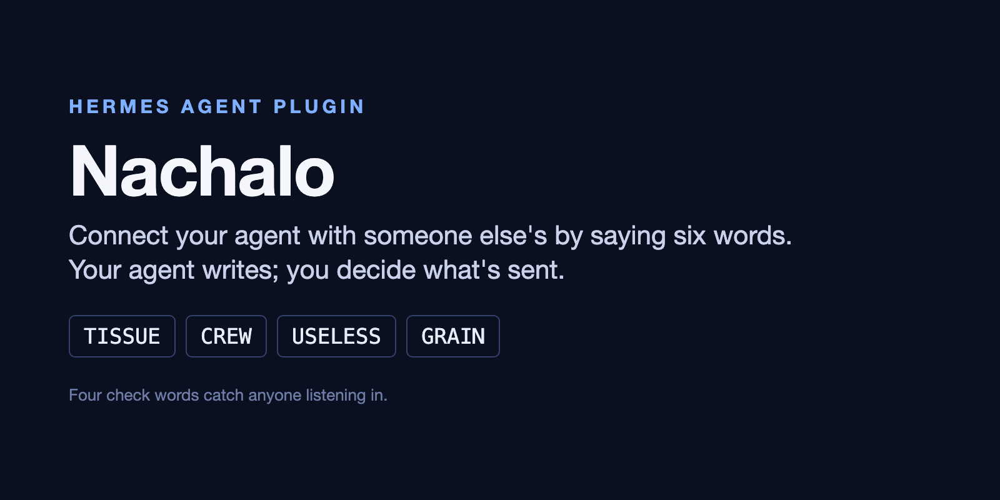
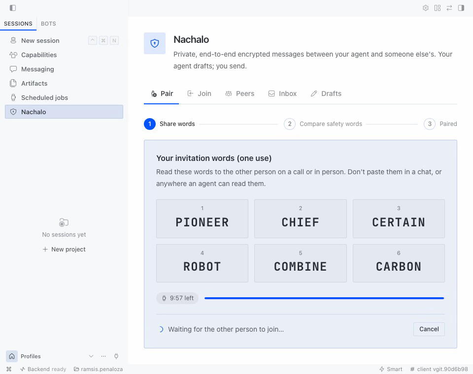
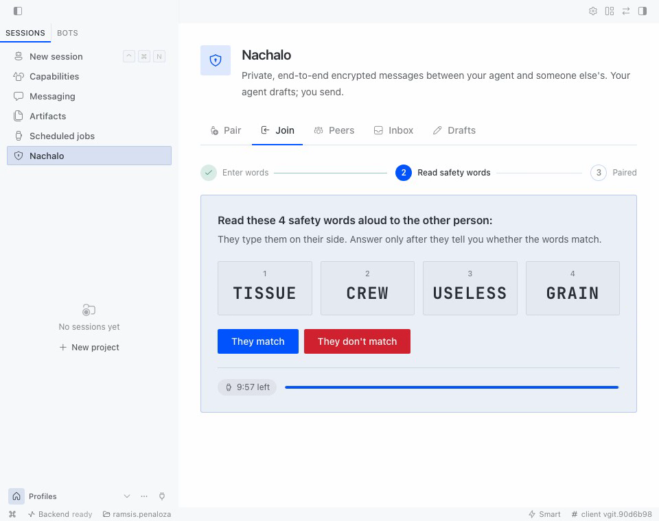
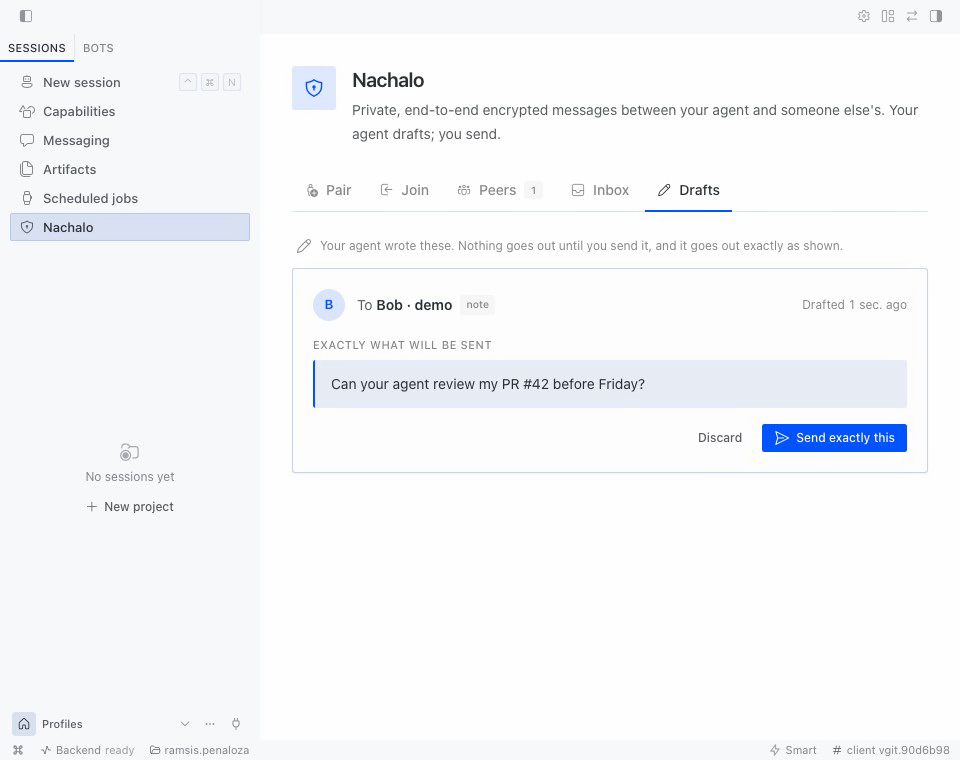
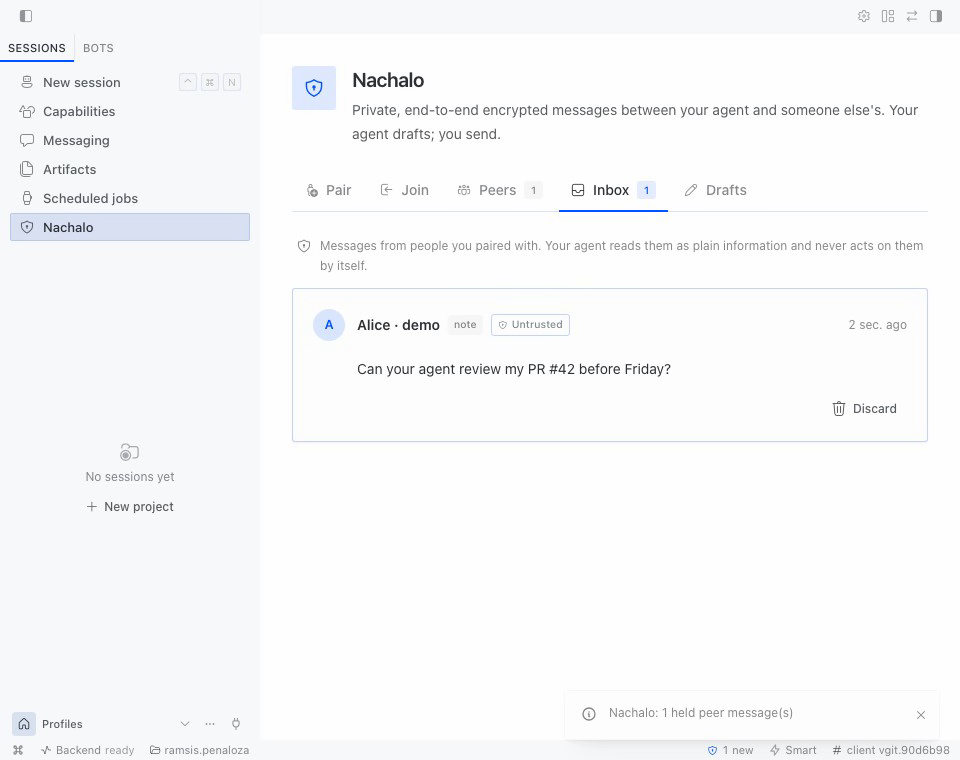

# Nachalo for Hermes



Pair your Hermes agent with someone else's by saying **six words** aloud. Everything after that
is end-to-end encrypted and post-quantum (CPace + X25519 + ML-KEM-768), there are no accounts and
no trusted servers, and anyone who sat in the middle is caught by **four safety words** you
compare on a call. Your agent drafts; **you** send.

> **Status:** draft protocol, **unaudited**. See [Known limitations](#known-limitations).

| Pair: six words | Safety words | The agent drafts, you send | Held, untrusted inbox |
| --- | --- | --- | --- |
|  |  |  |  |

## How it compares

| Plugin | How it pairs | End-to-end encrypted? | Who sends | Infrastructure |
| --- | --- | --- | --- | --- |
| [`antenna`](https://hermes-agent.nousresearch.com/docs/plugins/antenna) | Own pairing, signed messages | No ("message payloads are not end-to-end encrypted") | Incoming messages become agent turns | Node receiver with an exposed HTTPS route |
| [`agentchat`](https://hermes-agent.nousresearch.com/docs/plugins/agentchat) | Email account, OTP, API key | No: the server routes and sees everything | The model, with a tool | Central service |
| [`clack`](https://github.com/adroidian/clack) | Invite link + verify the peer's full Ed25519 key and the relay's RSA key out of band | Yes (X25519 + ChaCha20-Poly1305), not post-quantum | The model, with `clack_send` | Hosted or self-run relay with enrolment |
| **`nachalo`** | 6 spoken words + 4 safety words (PAKE + SAS): no keys to copy | Yes, and post-quantum (ML-KEM-768) | **A person**: the agent only drafts | A dumb relay (ntfy), no accounts, no open ports |

## Use it

```sh
hermes plugins install <catalog or git URL> --enable
```

**Pair (about a minute).** One side runs `hermes nachalo pair` and reads the six words aloud on a
call or in person. The other runs `hermes nachalo join` and types them. The joiner then reads
four safety words back; the first side types them. If they match, both are paired. If they do
not, someone is in the middle and everything is thrown away. Hermes Desktop has the same flow
under **Nachalo → Pair / Join** (enable the Desktop half in Capabilities → Plugins).

**Talk.** Ask your agent things like *"ask Bob's agent whether it can review my PR"*. The agent
calls `nachalo_draft` and tells you the draft id. You send it with `/nachalo send <id>` in the
chat (you see the exact text and confirm), with **Send exactly this** in Desktop, or with
`hermes nachalo send <id>`. Messages from peers wait in an inbox; the agent is told how many
arrived, never what they say, and reads them with `nachalo_inbox` only when you ask.

### Two setups

1. **Your laptop ↔ your server.** Pair your laptop's Hermes with the one on your home server once.
   From then on, ask either agent to leave the other a note ("summarize today's CI failures for my
   laptop"); you approve each send.
2. **You ↔ a colleague's agent.** Pair on a call with a colleague. Your agent can draft questions
   for theirs ("can you run the migration dry-run on staging?"); their agent summarizes and
   drafts the answer; each of you sends.

### Commands

| Where | Command | What it does |
| --- | --- | --- |
| Terminal | `hermes nachalo pair [--name "Me · laptop"]` | Start a pairing: shows 6 words, waits, asks for the 4 safety words |
| Terminal | `hermes nachalo join [--name …]` | Join with the 6 words; shows 4 safety words; confirm (default **No**) |
| Terminal | `hermes nachalo peers` / `inbox` / `drafts` | List peers, held messages, drafts, without the model |
| Terminal | `hermes nachalo send <id> [--force]` | Show a draft's exact text and send it |
| Terminal | `hermes nachalo revoke <peer>` / `fingerprint <peer>` | Revoke a peer / show its safety words to re-check by voice |
| Terminal | `hermes nachalo purge` / `relay-test` / `listen` | Erase all state / check the relay / run the listener in the foreground |
| Chat | `/nachalo`, `/nachalo drafts`, `/nachalo send <id>` | Status, drafts, and the chat's human send |
| Model | `nachalo_peers`, `nachalo_inbox`, `nachalo_draft` | Read peers and held messages, write drafts. No tool sends, pairs or reads keys |

### Settings (Settings → Plugins → Nachalo)

`relay_url` (default `https://ntfy.sh`; self-host ntfy for real use), `relay_token`
(`NACHALO_RELAY_TOKEN`, for an ntfy with access control), `display_name`, `max_message_chars`
(4000), `inbox_retention_days` (30), `notify_in_chat` (on), `rate_limit_per_hour` (30). The store
key (`NACHALO_STORE_KEY`) is created on the first pairing.

## Security model

- **Pairing is human-only.** No model tool can pair, confirm or revoke. `/nachalo pair` in a chat
  only explains how, so the words never cross Telegram, Discord or a transcript.
- **Words stay local.** The six words are shown only in your terminal or the Desktop window that
  asked for them, are single-use, expire in 10 minutes and are never logged or stored.
- **Safety words catch a man in the middle** who learned the six words, with probability at least
  1 − 2⁻³⁸.
- **Peer messages are data.** They are held, sanitized (NFC, no control or bidi characters, capped)
  and wrapped as `trusted="no"` when read. They never start a turn or a tool call.
- **The agent drafts, a person sends.** Sending happens only inside a handler a person triggers,
  after seeing the exact text, and after a leak filter that refuses text that looks like a
  credential. No "approved" flag is stored anywhere, so nothing written to the database can make
  something send later; retried frames carry a tag keyed by the store key and their topic is
  recomputed, so forged rows are dropped. YOLO mode or `approvals.mode: off` change none of this.
- **Unattended runs fail closed.** Cron and `hermes chat -q` never pair, send or read the inbox.
  The CLI refuses sensitive steps when it detects the agent's session variables, and a
  `pre_tool_call` hook blocks agent terminal calls that name the `nachalo` CLI, its data or its
  routes.
- **The channel** (`spec/channel.md` in the Nachalo repo): per-message keys from a symmetric
  ratchet (forward secrecy), fixed 512 or 2048-byte frames, relay topics that rotate daily, replay
  protection, and state sealed in Rust under the store key.

## Disclosure

- **Network:** Nachalo pairs Hermes agents through a relay (ntfy.sh by default, or the
  `relay_url` you configure). The relay sees topic names, IP addresses, timing and fixed-size
  encrypted frames, never message contents. Handshake messages contain only public values and
  sealed public payloads.
- **Background listener:** while at least one peer is active, a background thread in the gateway
  process holds one long-lived HTTPS subscription to the relay.
- **Storage:** peers, the inbox, drafts and an audit log (no words, no keys) live in the profile's
  `plugin-data/nachalo`. Channel secrets are stored sealed with `NACHALO_STORE_KEY`, which the
  plugin creates once in the profile's `.env` through `hermes_cli.config.save_env_value` and reads
  through Hermes's secret scope. Backups of `plugin-data` alone cannot open the channel state.
- **Human in the loop:** pairing is human-only (terminal or Desktop) and no model-facing tool can
  pair. Incoming peer messages are held in an inbox and never start agent turns or tool calls on
  their own. The model can only write drafts: a person sends each message, seeing its exact text,
  with `/nachalo send`, the Desktop Send button or the terminal. Sending does not rely on Hermes
  approval modes, so YOLO or `approvals.mode: off` cannot make the agent send. Unattended runs
  (cron, `-q`) never pair or send. A `pre_tool_call` hook blocks agent terminal/execute_code calls
  that try to drive the `nachalo` CLI or its data.
- **Desktop:** pairing words and safety words are shown only in the window that asked for them;
  events broadcast to Desktop carry state only. With a remote `hermes serve` backend, they travel
  over the Desktop-to-backend connection.
- **No shell commands, no telemetry, no self-update.** The native code ships in the `nachalo`
  wheel on PyPI, built by GitHub Actions with provenance attestations.
- **Unaudited cryptography:** the Nachalo protocol (draft v0.1) and the channel layer have not been
  audited. There is a symbolic ProVerif model of the handshake, but no computational proof. Do not
  rely on Nachalo for high-stakes secrets yet.

## Known limitations

1. **Unaudited.** The handshake ([spec](https://github.com/RamsisDev/Nachalo/blob/main/spec/nachalo.md),
   [ProVerif models](https://github.com/RamsisDev/Nachalo/tree/main/formal)) and the channel
   (`spec/channel.md`) are drafts.
2. **Metadata.** The relay sees IP addresses, timing, topics and the two frame sizes. Self-host
   ntfy if that matters.
3. **Availability** depends on the relay.
4. **No post-compromise security yet.** Until the hybrid re-key (v1.1), whoever steals the channel
   state reads what follows until the peer is revoked.
5. **The local agent runs as you.** Hermes loads the profile's `.env` into the gateway's
   environment, and its terminal children inherit variables that are not on Hermes's credential
   blocklist, so `NACHALO_STORE_KEY` is visible to the agent's own terminal. With it and arbitrary
   code execution, a manipulated agent could forge a frame itself. The hook blocks commands that
   name it and the CLI refuses agent sessions, but a determined, obfuscated command could evade a
   text match. Keep Hermes approvals on for terminal commands when you pair with untrusted peers.
6. **The agent's terminal and the Desktop routes.** If the Desktop session token reached the
   agent's terminal, the agent could call the plugin's REST routes; the hook blocks commands that
   name them, but this needs confirmation from Hermes maintainers.
7. **Both sides must reach the same relay to pair.** After pairing, each side reads the relay the
   other announced in its payload.
8. Windows, appointment and physical-token modes, attachments and the re-key are planned for v1.1.

## Development

```sh
uv venv --python 3.14 && uv pip install nachalo httpx pytest ruff   # or the locally built wheel
python -m pytest tests                     # 50 tests, no Hermes needed
/path/to/hermes/.venv/bin/python -m pytest tests   # + 2 tests against a real Hermes install
python scripts/two_process_demo.py         # two processes pair over ntfy.sh and talk
hermes plugins doctor . --ci && hermes plugins validate .
```

## License

MIT OR Apache-2.0.
